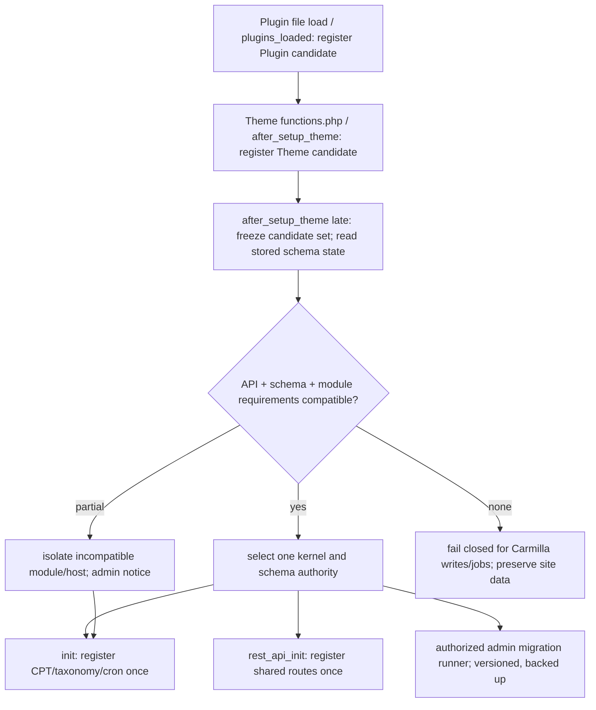

# ADR-007 — هستهٔ مشترک، دو میزبان و انتخاب نسخهٔ سازگار

- تاریخ: 2026-11-22
- وضعیت: قرارداد معماری P04-WPPLUGIN-ADR-002؛ پیاده‌سازی، نصب ZIP و Gate محصول هنوز انجام نشده است.
- بازبین فنی: Codex، 2026-11-22؛ بازبینی مستنداتی با کد زنده و [ADR-038](ADR-038-PRODUCT-OWNERSHIP-MATRIX.md). تصمیم تجاری یا تأیید انتشار نیست.
- مرجع تصمیم: [ADR-006](ADR-006-INDEPENDENT-PRODUCTS-AND-ENTITLEMENTS.md). ADR-005 فقط سابقهٔ تصمیم قبلی است.

## مرز بسته‌ها

هر ZIP، kernel نسخه‌دار و ماژول‌های SKU خودش را درون همان artifact دارد. نصب Theme به Plugin و نصب Plugin به Theme، companion plugin یا MU-plugin نیاز ندارد. `carmilla-core` سورس مشترک توسعه است، نه محصول سوم یا dependency نصب‌شونده. kernel تنها مالک ثبت domain CPT/schema/REST/cron/callback، permission و write service است؛ داده متعلق به سایت است. WooCommerce برای عملیات فروشگاهی مرجع داده و CRUD باقی می‌ماند.

| جزء | مسئولیت | محدودیت |
|---|---|---|
| Shared kernel داخل هر ZIP | قرارداد API/schema، دامنه، اعتبارسنجی، authorization، feature resolver، migration runner و REST مشترک | یک instance منتخب در هر request؛ هیچ host-specific fork در منطق دامنه |
| Theme Host | تنظیمات ظاهری، template و override نمایش، ورودی پنل و معرفی candidate | هیچ مسیر نوشتن مستقل دامنه یا مالکیت انحصاری schema ندارد |
| Plugin Host | پنل، shortcode/block/renderer و فرم عمومی با CSS محدود روی قالب ثالث، معرفی candidate | برای نمایش عمومی به Theme وابسته نیست؛ headless-only نیست |
| Shared build adapter در kernel | اعتبارسنجی entitlement و target، idempotency درخواست، ارسال و دریافت وضعیت job | Gradle/Xcode/signing/native packaging فقط روی runner ایزولهٔ خارج از WordPress؛ secret امضا در WordPress مشتری ذخیره نمی‌شود |

هر دو پنل وضعیت عملیاتی مشترک سایت را از resolver kernel می‌خوانند. انتخاب kernel بر اساس وجود کد و سازگاری انجام می‌شود؛ حق خرید به site/product/SKU/target با provenance متصل است و از میزبان منتخب یا نصب ZIP استنتاج نمی‌شود. نبود entitlement، قابلیت خاموش یا dependency ناقص باید عملیات جدید و API مستقیم را رد کند؛ داده پیشین حذف نمی‌شود. مسیرهای مجاز رسیدگی به عملیات پیشین و export مدیریتی با authorization جدا حفظ می‌شوند.

## ترتیب bootstrap و نقطهٔ انتخاب

در WordPress `plugins_loaded` را پیش از `after_setup_theme` و `init` اجرا می‌کند. پس boot در `plugins_loaded` زودهنگام است: Theme هنوز candidate خود را معرفی نکرده است. هر دو ورودی صرفاً metadata سبک candidate را ثبت می‌کنند: `product`, `kernelVersion`, `apiRange`, `schemaReadableRange`, `schemaWritableRange`, `moduleRequirements`, `path`, و `artifactDigest`. بارگذاری کلاس‌های دامنه، hookهای CPT/REST و migration پیش از انتخاب ممنوع است. candidateها با شناسهٔ محصول deduplicate می‌شوند؛ metadata فاقد امضا/ساختار معتبر رد می‌شود و path صرفاً از ZIP محلی معتبر خوانده می‌شود.

ترتیب hookها: [plugins_loaded](https://developer.wordpress.org/reference/hooks/plugins_loaded/)، [after_setup_theme](https://developer.wordpress.org/reference/hooks/after_setup_theme/)، [init](https://developer.wordpress.org/reference/hooks/init/) و [rest_api_init](https://developer.wordpress.org/reference/hooks/rest_api_init/) در مستند رسمی WordPress.

Coordinator از یک namespace پایدار و خنثی نسبت به نسخه استفاده می‌کند؛ candidateها metadata می‌دهند و کلاس kernel خود را تا پس از انتخاب load نمی‌کنند تا `class_exists` نسخهٔ اشتباه را قفل نکند. زمان freeze پس از معرفی Theme و پیش از `init` است؛ پیاده‌سازی باید ثابت کند همهٔ variantهای درخواست (REST، admin، cron و CLI) همین ترتیب را رعایت می‌کنند. activation/deactivation hookهای Plugin جدا ثبت می‌شوند، اما migration و ثبت خدمات مشترک فقط از coordinator منتخب می‌گذرد. Theme switch نیز صرفاً candidate فعال را عوض می‌کند، نه اینکه داده را حذف کند.

## نسخه و schema authority

coordinator ابتدا مجموعهٔ candidateهای قابل اجرا را از اشتراک دامنه‌های API دو host، schema ذخیره‌شده، requirements ماژول‌های فعال و نسخهٔ PHP/WP می‌سازد. فقط candidateای مجاز است که schema موجود را بخواند و writeهای مورد نیازش با آن سازگار باشد. سپس یک kernel سراسری از میان candidateهای سازگار با اولویت قطعی (`kernelVersion` سپس product id ثابت برای tie) انتخاب می‌شود؛ ماژول‌های ناسازگار جداگانه غیرفعال می‌شوند. این tie-break فقط پس از آزمون سازگاری است؛ first-loaded یا highest-version به‌تنهایی authority نیست. نسخه و شناسهٔ منتخب در request ثابت می‌ماند و برای diagnosis ثبت می‌شود؛ metadata entitlement از آن جداست.

Migration تنها توسط runner مشترک، با lock، schema target نسخه‌دار، backup/snapshot و امکان ادامه یا forward-fix انجام می‌شود. schema جدید بدون مسیر خواندن سازگار برای میزبان باقی‌مانده اعمال نمی‌شود؛ downgrade کور ممنوع است. در mismatch، ماژول/میزبان ناسازگار بدون ثبت route/write/job خود متوقف و اخطار قابل اقدام برای مدیر نشان داده می‌شود. اگر هیچ candidate سازگار برای domain باقی نماند، عملیات جدید آن domain بسته می‌شود؛ WordPress و WooCommerce مستقل باید به کار خود ادامه دهند. هیچ fallback به kernel زودتر loadشده، مسیر نوشتن دوم یا اعطای مجوز به‌علت خرابی resolver مجاز نیست. سیاست دقیق نسخهٔ schema، lock و migration در P04-WPPLUGIN-CODE-003 پیاده و آزمایش می‌شود.

## حالت‌ها و انتقال

| حالت | انتخاب و عملیات | داده/مجوز |
|---|---|---|
| Theme-only | candidate Theme انتخاب؛ kernel داخلی، API و UI محصول فعال | سایت مالک؛ entitlement همان محصول و سایت بررسی می‌شود |
| Plugin-only | candidate Plugin انتخاب؛ renderer عمومی روی قالب ثالث، API و پنل فعال | همان storage و شناسه‌ها؛ Theme لازم نیست |
| Both سازگار | یک kernel؛ Theme می‌تواند view را override کند؛ یک CPT/route/callback/job | یک schema و یک write path؛ provenance هر خرید حفظ می‌شود |
| Both با mismatch | فقط ماژول سازگار فعال؛ ناسازگار fail closed و notice | داده محفوظ؛ بدون migration ناسازگار یا bypass مجوز |
| خاموشی یکی | candidate باقی‌مانده دوباره با schema و entitlement سنجیده می‌شود | انتقال بدون کپی داده؛ اگر ناسازگار است write متوقف و راه ارتقا اعلام می‌شود |
| خاموشی آخرین میزبان | هیچ خدمات یا API/job جدید Carmilla | داده، ID، سفارش و artifact قبلی خودکار حذف نمی‌شوند |

انتقال به میزبان دیگر به بستهٔ دارای همان ماژول، entitlement معتبر برای همان سایت و schema قابل خواندن/نوشتن نیاز دارد. انتقال مجوز، alias شناسه‌ها و adoption داده، عملیات صریح و قابل آزمون کارت‌های بعدی است؛ این ADR مجوز migration واقعی نیست. rollback سند با بازگرداندن همین diff ممکن است؛ rollback schema فقط با snapshot و forward-fix مجاز است.

## شواهد و آزمون بعدی

کد فعلی در `carmilla-bridge.php` در `plugins_loaded`، و Theme در `functions.php` در `after_setup_theme`، `Carmilla_Kernel::boot` را صدا می‌زند. `class_exists` و ثبت‌های CPT در هر دو میزبان هنوز قرارداد بالا را اجرا نمی‌کنند. قرارداد این ADR به معنی PASS نصب ZIP، migration، HTTP/UI یا App Builder نیست. کارت‌های CODE/QA فاز P04 باید Theme-only، Plugin-only، both، ترتیب نسخه، mismatch، خاموشی هر میزبان و حفظ write واحد را با ZIP واقعی و دادهٔ ساختگی ثابت کنند.
